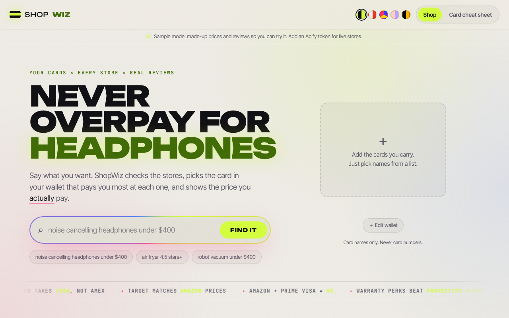

# ShopWiz



Find the lowest real price for something you want to buy. ShopWiz checks the stores, picks the card in your wallet that earns the most at each one, and shows what you actually pay after rewards. It also tells you how far to trust the product's rating.

## What it does

- **Real price per store.** Price minus the rewards from your best card at that store, with an optional cash back portal estimate.
- **Which card to swipe.** Uses each card's categories and caps, store categories (Amazon, Walmart.com, Target, warehouse clubs and others), the card networks a store accepts (Costco doesn't take Amex), and rotating 5% categories you've activated.
- **Price match tip.** Some stores match a competitor's lower price. If one of your cards earns more at that store, ShopWiz tells you to buy there and ask for the match.
- **Sign-up bonus mode.** If you're working toward a card's welcome bonus, it shows what the purchase does to your progress and what you give up.
- **Trust-adjusted rating.** Combines star ratings across stores, pulls products with few ratings toward average, and discounts reviews that look fake (unverified 5-star reviews, short generic text, copied text, bursts on one day).
- **Hidden costs and returns.** Counts Costco's non-member surcharge, flags stores that need a membership, and shows each store's return window.
- **What owners say.** Breaks reviews into topics (comfort, battery, durability and more) with the share of happy owners.
- **Coupons from your inbox.** Connect Gmail (read-only) and ShopWiz finds promo codes, rewards and offers made for you in the last 30 days of promotions, then counts them in each store's price. Card rewards are worked out on the price after the coupon. Email text is read in memory and never saved; the sign-in token sits in an http-only cookie for up to an hour.
- **Card perks.** Points out extended warranty and purchase protection, so you can skip the store's protection plan.
- **Which card when.** A guide to the best card in your wallet for groceries, dining, gas, Amazon, online shopping and more.
- **Plain-English search.** "air fryer under $120, 4.5 stars+" becomes a search with filters. If an AI key and model are set, a small language model handles harder requests; otherwise simple rules do it.

ShopWiz only asks for card names. It never asks for card numbers.

## Run it

```bash
pip install -r requirements.txt
uvicorn app:app --reload
```

Open http://localhost:8000. Without an Apify token the app runs on sample data (three headphones) and says so on screen.

For live prices and reviews, set an [Apify](https://apify.com) token:

```bash
export APIFY_TOKEN=...
uvicorn app:app --reload
```

| Setting | What it does |
|---|---|
| `APIFY_TOKEN` | Turns on live store prices and reviews |
| `GOOGLE_CLIENT_ID`, `GOOGLE_CLIENT_SECRET` | Turns on "Connect Gmail" (see below) |
| `ANTHROPIC_API_KEY`, `SHOPWIZ_AI_MODEL` | Optional: API key and a small model id, for harder search requests and review summaries |
| `SHOPWIZ_SHOPPING_ACTOR` | Google Shopping actor (default `experthasan~google-shopping-scraper`) |
| `SHOPWIZ_REVIEWS_ACTOR` | Amazon reviews actor (default `junglee~amazon-reviews-scraper`) |
| `SHOPWIZ_VISITOR_LIMIT` | Live (uncached) lookups one visitor can make per hour (default 15) |
| `SHOPWIZ_DAILY_LIMIT` | Live lookups the whole site can make per day (default 300) |

### Gmail setup

1. In Google Cloud Console, create a project, enable the **Gmail API**, and set up the OAuth consent screen (External, Testing).
2. Add yourself and anyone trying the app as **test users**.
3. Create an OAuth client of type **Web application** with the redirect URI `http://localhost:8000/auth/google/callback` (plus your deployed URL's `/auth/google/callback`).
4. Set `GOOGLE_CLIENT_ID` and `GOOGLE_CLIENT_SECRET` and restart.

`gmail.readonly` is a restricted scope. In Testing mode it works for up to 100 test users. A public launch needs Google's app verification and a security assessment.

### Cost

Searches ask for 20 products and results are cached for an hour. A search costs a few cents. Reviews are only fetched for Amazon listings, capped at 100 per product.

## Hosting

The repo deploys to Vercel as is (`vercel.json` sets the FastAPI preset). Add `APIFY_TOKEN` under Project Settings > Environment Variables and redeploy. Until then the site runs in sample mode.

A public site spends your Apify credit, so ShopWiz limits uncached lookups per visitor and per day. Those counters are in memory and reset when the server restarts, so also set a monthly usage limit in Apify (Settings > Usage limits) as the hard cap.

## Tests

```bash
python -m pytest -q
```

## Data

- `data/cards.json`: earning rules for 19 popular cards. Card terms change, so check `as_of` and update.
- `data/merchants.json`: store categories, accepted networks and price match policies.
- `data/portals.json`: typical cash back portal rates (estimates).

## Project layout

```
app.py                 web API and static site
shopwiz/cards.py     card rules and store matching
shopwiz/optimize.py  best card per store, ranking, wallet guide
shopwiz/ratings.py   trust-adjusted rating
shopwiz/extras.py    price match, sign-up bonus, plain-English search
shopwiz/coupons.py   coupon and personal offer extraction from emails
shopwiz/gmail.py     Gmail sign-in and reading promotions
shopwiz/apify.py     Apify calls
public/                website
```
